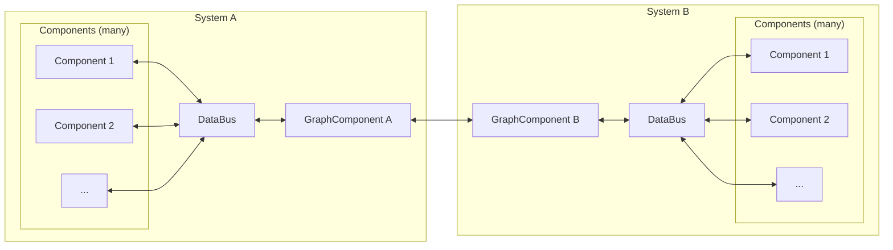

# DesignedSystem

**ACTIVE DEVELOPMENT**

A C++26 modular component demo with a local data bus, database, logging and
terminal notification components, plus a simulated Graph notification demo. 

No Program Photo, just the Doggo

<p align="center">
  
</p>

## Linux prerequisites

The project is built and tested on Linux with GCC 16.2.1, CMake 3.30 or newer,
and Ninja. The compiler and its standard library must support C++26 modules and
`import std;`; many distributions' default GCC versions may be too old.

**Required development TOOLS and LIBRARIES**

Tools:
- GCC/G++ with C++26 and `import std;` support
- CMake 3.30+ (for modern features)
- Ninja (for modules)
- Bash
- `pkg-config` (for cmakelists.txt library targeting)

Libraries:
- Boost headers and Boost.System (Asio and Beast)
- websocketpp
- OpenSSL
- PostgreSQL client libraries: libpq and libpqxx
- POSIX threads

On Debian/Ubuntu, install the packaged dependencies with:

```sh
sudo apt update
sudo apt install build-essential cmake ninja-build pkg-config \
  libboost-dev libboost-system-dev libwebsocketpp-dev libssl-dev \
  libpq-dev libpqxx-dev
```

On Arch Linux, install the equivalent packages with:

```sh
sudo pacman -Syu --needed base-devel gcc cmake ninja pkgconf \
  boost boost-libs websocketpp openssl postgresql-libs libpqxx
```

`postgresql-libs` supplies the client library required to build. Install the
`postgresql` package separately only if you also want a local PostgreSQL
server; the executable can connect to a server configured through
`DESIGNED_SYSTEM_DSN`.

Install or select a sufficiently recent GCC separately if your distribution's
default toolchain does not provide the required C++26 standard library. For
example, if `g++-16` is installed and provides `import std`, use
`CXX=g++-16 ./autobuild.sh` for the first configuration. If the preset was
already configured with another compiler, use a fresh `build/linux-dev`
directory before switching.

The current CMake configuration expects libpqxx at
`/usr/lib/libpqxx.so` with headers under `/usr/include`. Some distributions use
a multiarch library directory instead; in that case, adjust the imported
`custom_pqxx` location in `src/CMakeLists.txt`.

## Build on Linux

Run the build script from the repository root:

```sh
./autobuild.sh
```

The script configures the `dev` CMake workflow, builds with Ninja, and installs
the executable into `dist/DesignedSystem`. It removes the existing `dist/`
directory before building, so do not keep unrelated files there.

To run the build steps manually:

```sh
cmake --preset linux-dev
cmake --build --preset dev-build
cmake --build --preset dev-install
```

The pre-installed executable is at `build/linux-dev/src/DesignedSystem`.

## Usage

The sample program starts the logging and notification components, demonstrates
a Graph notification between an in-memory root and peer, then connects to
PostgreSQL, creates the `designed_system_demo` table if needed, and inserts a
sample notification.

Run the installed executable:

```sh
./dist/DesignedSystem
```

The default PostgreSQL connection string is:

```text
dbname=postgres user=postgres hostaddr=127.0.0.1 port=5432
```

Set `DESIGNED_SYSTEM_DSN` to use another database; no prompt is shown:

```sh
export DESIGNED_SYSTEM_DSN="host=127.0.0.1 port=5432 dbname=mydb user=myuser"
./dist/DesignedSystem
```

The selected database must be running and the configured user must be allowed
to create the demo table and insert rows. The logger writes to
`designed-system.log` in the current working directory.

### About the Graph demo

The Graph example in `main()` uses `PointerChannel` to connect two `Process`
objects in the same process. The sample notification is printed at the root
and simulated peer. This is an in-memory demonstration: it does not open a
network connection or require TLS certificates. The Graph module also contains
WebSocket/TLS transport APIs for applications that configure remote processes
and their channels.

## Planned distributed architecture

The intended design connects two independent systems through a GraphComponent
on each side:



Each GraphComponent will adapt selected local DataBus events into Graph
messages, then decode incoming messages and publish them on its own DataBus.
Received messages should not be broadcast back onto Graph, which prevents
echo loops. This is the planned architecture; the current executable only
demonstrates the in-process Graph notification path described above.
